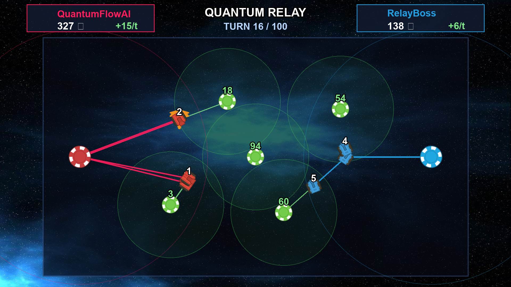
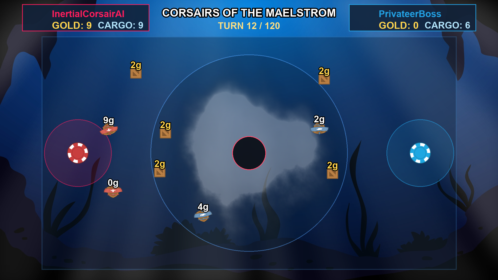
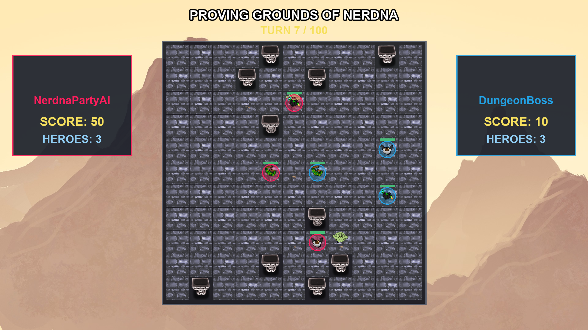
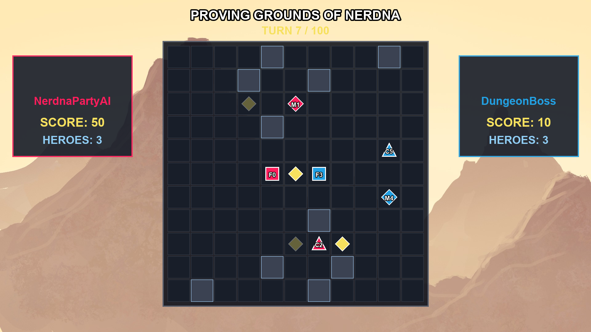
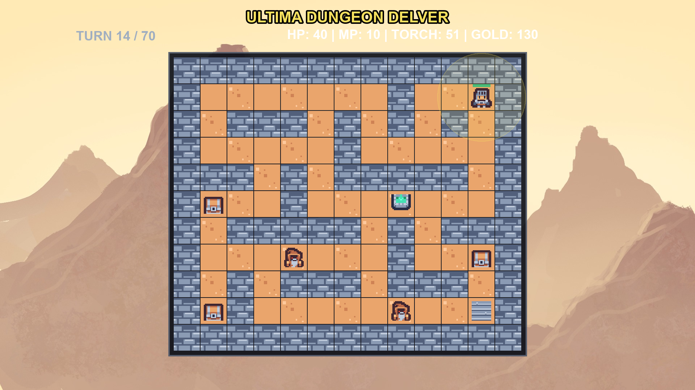
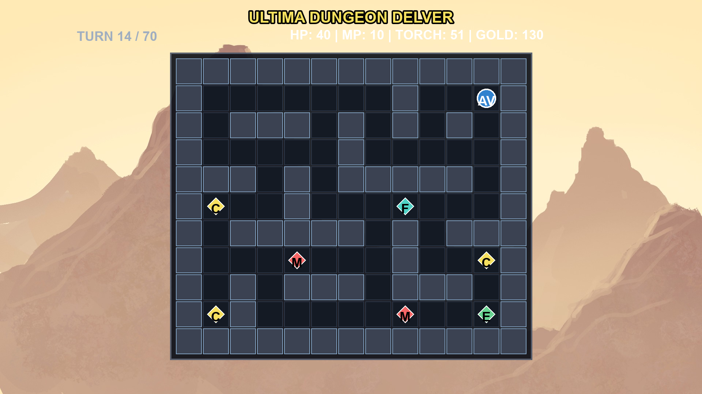
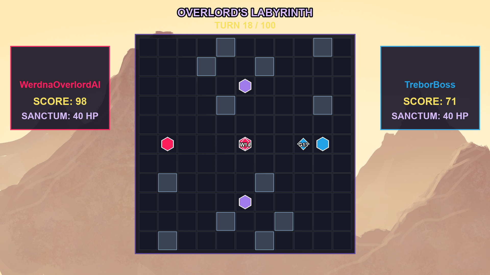

# CodinGame SDK Puzzles Hub — 6 Jeux Multijoueurs & RPG (`codingame-game-engine` v4.7.7)

> 🌐 **Site GitHub Pages Interactif (Captures d'écran, Règles & Lecteur PixiJS de 18 Replays en Direct) :**
> **[https://codingame-team.github.io/codingame-sdk-puzzles/](https://codingame-team.github.io/codingame-sdk-puzzles/)**

Ce dépôt centralise nos **6 puzzles communautaires CodinGame** développés avec le SDK officiel `codingame-game-engine` **v4.7.7** (Java 17 & PixiJS v6) :
* **Série 1 (Puzzles Algorithmiques Multijoueurs 1v1)** : *Chrono-Tactics*, *Quantum Relay*, *Corsairs of the Maelstrom*.
* **Série 2 (Puzzles Thématiques RPG avec Viewer PixiJS Dual-Mode `RPG SPRITES` / `GEOMETRIC DEBUG`)** : *Proving Grounds of Nerdna*, *Ultima: Dungeon Delver*, *Overlord's Labyrinth*.

---

## 1. Tableau Récapitulatif des 6 Puzzles

| # | Puzzle | Catégorie | Dépôt Source GitHub (`@codingame-team`) | Contribution CodinGame | Jouer dans l'IDE CodinGame | Replay PixiJS (GitHub Pages) |
| :--- | :--- | :--- | :--- | :--- | :--- | :--- |
| **1** | **Chrono-Tactics** | `bot-programming` (3 ligues) | [codingame-chrono-tactics](https://github.com/codingame-team/codingame-chrono-tactics) | [Contribution](https://www.codingame.com/contribute/view/15861375695065563529e288291b702e8df659) | [Démo IDE](https://www.codingame.com/ide/demo/160565706ec1b3064e2be42d9cc50401b0ae417) | [Replay Live](https://codingame-team.github.io/codingame-sdk-puzzles/replays/chrono-tactics/test.html?replay=replay2.json) |
| **2** | **Quantum Relay** | `bot-programming` (3 ligues) | [codingame-quantum-relay](https://github.com/codingame-team/codingame-quantum-relay) | [Contribution](https://www.codingame.com/contribute/view/15864612ee375b7372711a629aff1930a46f01) | [Démo IDE](https://www.codingame.com/ide/demo/1605690daf156413f9393afba6e22199f0011bc) | [Replay Live](https://codingame-team.github.io/codingame-sdk-puzzles/replays/quantum-relay/test.html?replay=replay3.json) |
| **3** | **Corsairs of the Maelstrom** | `bot-programming` (3 ligues) | [codingame-corsairs-maelstrom](https://github.com/codingame-team/codingame-corsairs-maelstrom) | [Contribution](https://www.codingame.com/contribute/view/158647b537dec10e539706b149bde5a6c7442f) | [Démo IDE](https://www.codingame.com/ide/demo/1605692ff7906372a45b3320918ac8fbdaaa75f) | [Replay Live](https://codingame-team.github.io/codingame-sdk-puzzles/replays/corsairs-maelstrom/test.html?replay=replay3.json) |
| **4** | **Proving Grounds of Nerdna** | `bot-programming` (RPG 1v1) | [codingame-proving-grounds-nerdna](https://github.com/codingame-team/codingame-proving-grounds-nerdna) | [Contribution](https://www.codingame.com/contribute/view/15867946f675bf476dc7f164eb3db1d6ce58f6) | [Démo IDE](https://www.codingame.com/ide/demo/1605773233912493b234f7c05aadee6e291708f) | [Replay Live](https://codingame-team.github.io/codingame-sdk-puzzles/replays/proving-grounds-nerdna/test.html?replay=replay3.json) |
| **5** | **Ultima: Dungeon Delver** | `optimization` (RPG Solo) | [codingame-ultima-dungeon-delver](https://github.com/codingame-team/codingame-ultima-dungeon-delver) | [Contribution](https://www.codingame.com/contribute/view/158680d08ca9d3d2323c3495364e30863bbe90) | [Démo IDE](https://www.codingame.com/ide/demo/1605775f633efb9245a42848603a5d4018881dc) | [Replay Live](https://codingame-team.github.io/codingame-sdk-puzzles/replays/ultima-dungeon-delver/test.html?replay=replay1.json) |
| **6** | **Overlord's Labyrinth** | `bot-programming` (RPG 1v1) | [codingame-overlords-labyrinth](https://github.com/codingame-team/codingame-overlords-labyrinth) | [Contribution](https://www.codingame.com/contribute/view/1586818a88014df499301a39a4dbd615c75dfe) | [Démo IDE](https://www.codingame.com/ide/demo/16057779640832b6c2b793a6dd8f1b789d4447d) | [Replay Live](https://codingame-team.github.io/codingame-sdk-puzzles/replays/overlords-labyrinth/test.html?replay=replay3.json) |

---

## 2. Captures d'Écran & Règles de Fonctionnement

### 1. Chrono-Tactics (`codingame-chrono-tactics`)

* **Objectif & Règles** : Contrôlez jusqu'à 3 unités sur une arène symétrique **11×11** dont les dalles s'effondrent (`3 -> 2 -> 1 -> 0` = gouffre mortel). Capturez les Chrono-Balises (`+2 pts/tour`), posez des bombes temporelles `BOMB tx ty` en croix pour isoler l'adversaire et repoussez les unités ennemies dans le vide avec `PUSH <N|E|S|W>`.
* **Sortie par unité** : `MOVE x y [BOMB tx ty | PUSH <N|E|S|W>]`

---

### 2. Quantum Relay (`codingame-quantum-relay`)

* **Objectif & Règles** : Dans une arène spatiale continue **1600×900**, déplacez vos drones (`MOVE x y`) pour capturer des Relais Quantiques, tissez un arbre couvrant de faisceaux énergétiques (`LINK id1 id2`) sans croiser les faisceaux adverses et surchargez vos nœuds (`OVERCHARGE nodeId`) pour maximiser le flux transmis à votre Core.
* **Sortie par drone** : `MOVE x y [LINK id1 id2 | OVERCHARGE nodeId]`

---

### 3. Corsairs of the Maelstrom (`codingame-corsairs-maelstrom`)

* **Objectif & Règles** : Pilotez 2 navires corsaires soumis à une physique inertielle (`DRAG = 0.78`) à **masse variable selon l'or embarqué** (`accel = power / (1 + 0.15 * gold)`). Collectez les coffres, compensez le courant tourbillonnant du Maelström central (`(800, 450)`), utilisez l'ancre d'urgence `ANCHOR` et tirez des boulets répulsifs `FIRE tx ty` pour projeter l'adversaire dans l'œil du cyclone.
* **Sortie par navire** : `THRUST x y power | ANCHOR | FIRE tx ty`

---

### 4. Proving Grounds of Nerdna (`codingame-proving-grounds-nerdna`)
| Mode `RPG SPRITES` | Mode `GEOMETRIC DEBUG` |
| :---: | :---: |
|  |  |

* **Objectif & Règles** : Dirigez une compagnie RPG tactique (**Fighter**, **Mage**, **Cleric**) inspirée de *Wizardry* et *D&D 5e* sur une grille de donjon **11×11**. Éliminez les Gardiens Morts-Vivants (`18 PV`, `+10 pts`), récupérez les Coffres de Reliques (`+25 à +35 pts`) et combinez `SLASH targetId`, `GUARD allyId`, `FIREBALL tx ty` (*MAHALITO*, AoE 8 dégâts) et `HEAL allyId` (*DIOS*, +10 PV).
* **Sortie par héros** : `MOVE x y [SLASH id | GUARD id | FIREBALL tx ty | HEAL id]`

---

### 5. Ultima: Dungeon Delver (`codingame-ultima-dungeon-delver`)
| Mode `RPG SPRITES` | Mode `GEOMETRIC DEBUG` |
| :---: | :---: |
|  |  |

* **Objectif & Règles** : Puzzle solo d'Optimisation inspiré d'*Ultima IV*. Guidez l'**Avatar** (`40 PV`, `20 PM`, `65 tours de Torche`) à travers un donjon **13×11**, éliminez les Monstres (`M`, +20 Or) et Gardiens de Reliques des Vertus (`R`, +60 Or) avec `STRIKE tx ty` ou `FLAM_POR tx ty` (15 dégâts, 5 PM), soignez-vous avec `MANI` (+14 PV, 4 PM) ou aux Fontaines (`F`, +18 PV, +10 Torche) et rejoignez l'Escalier de Sortie (`E`, +50 Or + bonus Torche).
* **Sortie par tour** : `MOVE x y [STRIKE tx ty | FLAM_POR tx ty | MANI]`

---

### 6. Overlord's Labyrinth (`codingame-overlords-labyrinth`)
| Mode `RPG SPRITES` | Mode `GEOMETRIC DEBUG` |
| :---: | :---: |
|  |  |

* **Objectif & Règles** : Duel tactique inspiré du plateau d'Overlord de *Conan: Book of Skelos* et de *Nerdna*. Répartissez à chaque tour vos **Gemmes d'Énergie** (`5 + leagueLevel + pentagrammesContrôlés`) entre l'invocation de serviteurs `SUMMON pentagramId <HOUND|GUARD|WRAITH>` sur les 5 Pentagrammes du labyrinthe et l'activation de vos troupes `ACTIVATE minionId targetX targetY` pour détruire le Sanctuaire adverse (`40 PV`).
* **Sortie par tour** : `SUMMON pentagramId TYPE ; ACTIVATE minionId targetX targetY`
