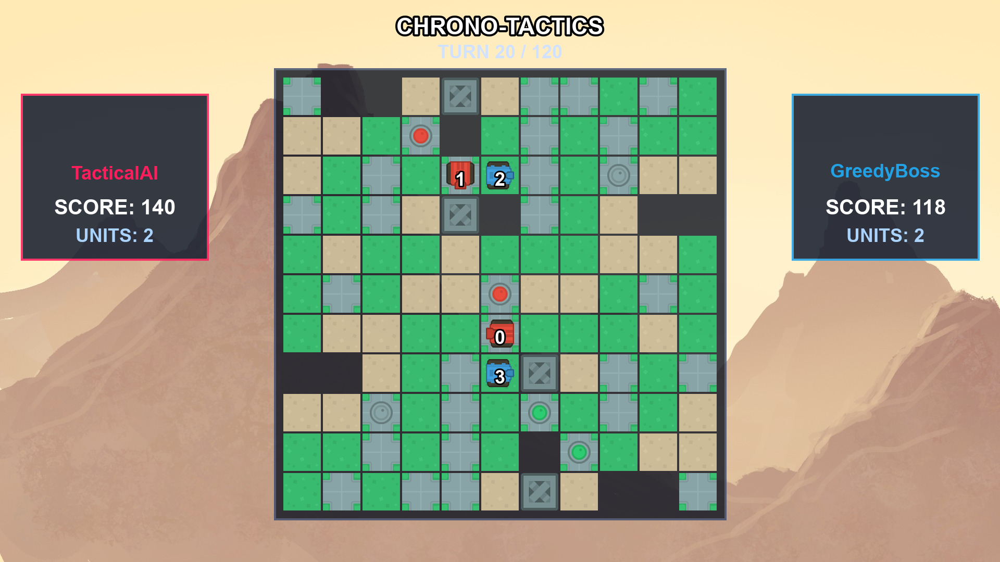
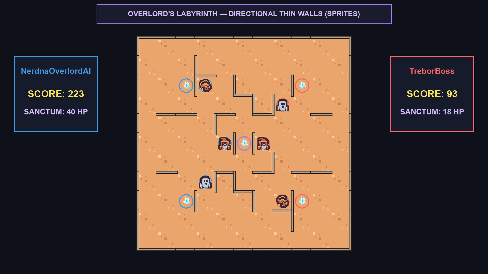
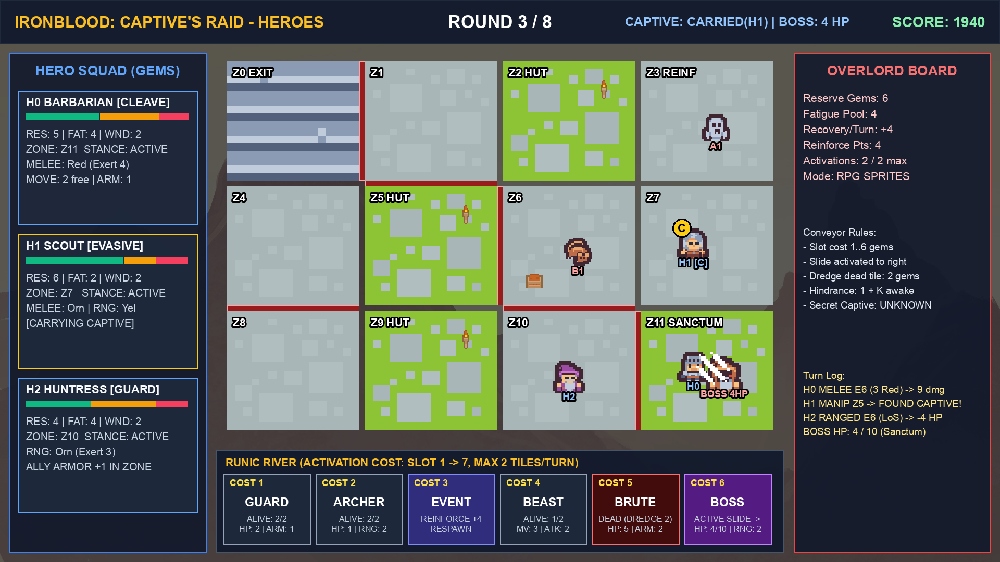
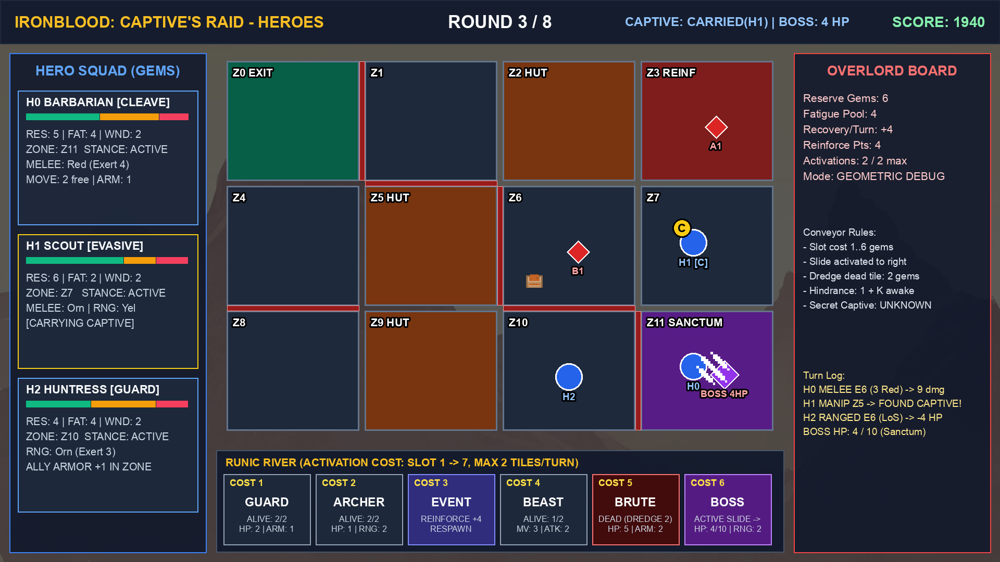
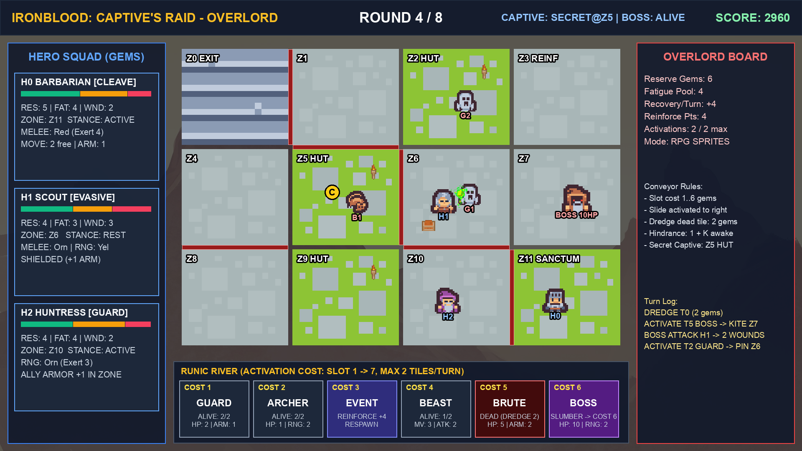
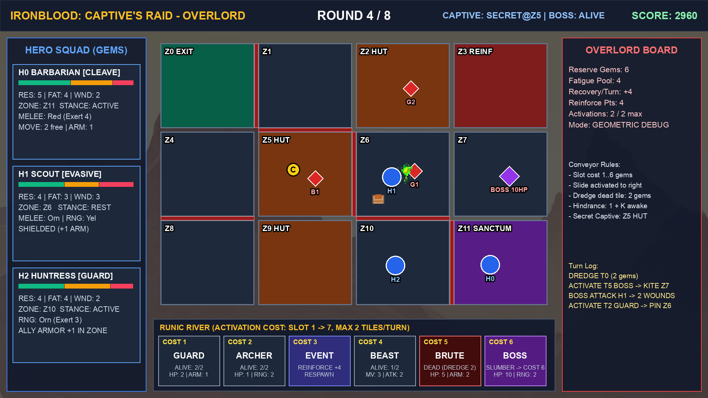

> 🇫🇷 [Version française](README_fr.md)

# CodinGame SDK Puzzles Hub — 8 Multiplayer & RPG Games (`codingame-game-engine` v4.7.7)

> 🌐 **Interactive GitHub Pages Showcase (EN / FR / DE / JP, HD Screenshots, Rules & 24 Live PixiJS Replays):**
> **[https://cgphilrg.github.io/codingame-sdk-puzzles/](https://cgphilrg.github.io/codingame-sdk-puzzles/)**

This repository centralizes our **8 CodinGame community puzzles** built with the official `codingame-game-engine` **v4.7.7** SDK (Java 17 & PixiJS v6):
* **Series 1 (1v1 Algorithmic Bot-Programming Puzzles):** *Chrono-Tactics*, *Quantum Relay*, *Corsairs of the Maelstrom*.
* **Series 2 (Tactical RPG Puzzles with Dual-Mode PixiJS Viewer `RPG SPRITES` / `GEOMETRIC DEBUG` & CC0 Sprite Banks):** *Proving Grounds of Nerdna*, *Ultima: Dungeon Delver*, *Overlord's Labyrinth*.
* **Series 3 (Ironblood Chronicles — Mirrored Solo Optimization Duo with Zones, Gem Pool & Runic River):** *Ironblood: Captive's Raid - Heroes*, *Ironblood: Captive's Raid - Overlord*.

---

## 1. Overview Table of the 8 Puzzles

| # | Puzzle | Category | GitHub Repository (`@CGphilRG`) | CodinGame Contribution | Play in CodinGame IDE | PixiJS Replay (GitHub Pages) |
| :--- | :--- | :--- | :--- | :--- | :--- | :--- |
| **1** | **Chrono-Tactics** | `bot-programming` (Wood 3/2/1) | [codingame-chrono-tactics](https://github.com/CGphilRG/codingame-chrono-tactics) | [Contribution](https://www.codingame.com/contribute/view/15861375695065563529e288291b702e8df659) | [IDE Demo](https://www.codingame.com/ide/demo/160565706ec1b3064e2be42d9cc50401b0ae417) | [Live Replay](https://cgphilrg.github.io/codingame-sdk-puzzles/replays/chrono-tactics/test.html?replay=replay2.json) |
| **2** | **Quantum Relay** | `bot-programming` (Wood 3/2/1) | [codingame-quantum-relay](https://github.com/CGphilRG/codingame-quantum-relay) | [Contribution](https://www.codingame.com/contribute/view/15864612ee375b7372711a629aff1930a46f01) | [IDE Demo](https://www.codingame.com/ide/demo/1605690daf156413f9393afba6e22199f0011bc) | [Live Replay](https://cgphilrg.github.io/codingame-sdk-puzzles/replays/quantum-relay/test.html?replay=replay3.json) |
| **3** | **Corsairs of the Maelstrom** | `bot-programming` (Wood 3/2/1) | [codingame-corsairs-maelstrom](https://github.com/CGphilRG/codingame-corsairs-maelstrom) | [Contribution](https://www.codingame.com/contribute/view/158647b537dec10e539706b149bde5a6c7442f) | [IDE Demo](https://www.codingame.com/ide/demo/1605692ff7906372a45b3320918ac8fbdaaa75f) | [Live Replay](https://cgphilrg.github.io/codingame-sdk-puzzles/replays/corsairs-maelstrom/test.html?replay=replay3.json) |
| **4** | **Proving Grounds of Nerdna** | `bot-programming` (RPG 1v1, Draft) | [codingame-proving-grounds-nerdna](https://github.com/CGphilRG/codingame-proving-grounds-nerdna) | [Contribution](https://www.codingame.com/contribute/view/15867946f675bf476dc7f164eb3db1d6ce58f6) | [IDE Demo](https://www.codingame.com/ide/demo/1605773233912493b234f7c05aadee6e291708f) | [Live Replay](https://cgphilrg.github.io/codingame-sdk-puzzles/replays/proving-grounds-nerdna/test.html?replay=replay3.json) |
| **5** | **Ultima: Dungeon Delver** | `optimization` (Solo RPG, Draft) | [codingame-ultima-dungeon-delver](https://github.com/CGphilRG/codingame-ultima-dungeon-delver) | [Contribution](https://www.codingame.com/contribute/view/158680d08ca9d3d2323c3495364e30863bbe90) | [IDE Demo](https://www.codingame.com/ide/demo/1605775f633efb9245a42848603a5d4018881dc) | [Live Replay](https://cgphilrg.github.io/codingame-sdk-puzzles/replays/ultima-dungeon-delver/test.html?replay=replay1.json) |
| **6** | **Overlord's Labyrinth** | `bot-programming` (RPG 1v1, Draft) | [codingame-overlords-labyrinth](https://github.com/CGphilRG/codingame-overlords-labyrinth) | [Contribution](https://www.codingame.com/contribute/view/1586818a88014df499301a39a4dbd615c75dfe) | [IDE Demo](https://www.codingame.com/ide/demo/16057779640832b6c2b793a6dd8f1b789d4447d) | [Live Replay](https://cgphilrg.github.io/codingame-sdk-puzzles/replays/overlords-labyrinth/test.html?replay=replay3.json) |
| **7** | **Ironblood: Captive's Raid - Heroes** | `optimization` (Solo Raid RPG, Draft) | [codingame-ironblood-raid-heroes](https://github.com/CGphilRG/codingame-ironblood-raid-heroes) | [Contribution](https://www.codingame.com/contribute/view/158844f920de66be1dc6f47b5aae512c58ccbb) | [IDE Demo](https://www.codingame.com/ide/demo/1606583ac3c5fb148e53d66cf306033068e1182) | [Live Replay](https://cgphilrg.github.io/codingame-sdk-puzzles/replays/ironblood-raid-heroes/test.html?replay=replay1.json) |
| **8** | **Ironblood: Captive's Raid - Overlord** | `optimization` (Solo Defense RPG, Draft) | [codingame-ironblood-raid-overlord](https://github.com/CGphilRG/codingame-ironblood-raid-overlord) | [Contribution](https://www.codingame.com/contribute/view/158845b8c4e7c6304d50f4f79b36eafa544c73) | [IDE Demo](https://www.codingame.com/ide/demo/1606585da9258ae0b4f82aa577b5ad11e6756a6) | [Live Replay](https://cgphilrg.github.io/codingame-sdk-puzzles/replays/ironblood-raid-overlord/test.html?replay=replay1.json) |

---

## 2. Screenshots & Game Mechanics

### 1. Chrono-Tactics (`codingame-chrono-tactics`)

* **Goal & Rules**: Command up to 3 units on a rotationally symmetric **11×11** grid where tiles crumble (`3 -> 2 -> 1 -> 0` = lethal void) and outer rings degrade every 20 turns (**Chrono-Storm**). Capture Chrono-Beacons (`+2 pts/turn`), deploy `BOMB tx ty` to break bridges, and `PUSH tx ty` adjacent units into the void.
* **Output per unit**: `[MOVE x y | WAIT] [BOMB tx ty | PUSH tx ty] [MSG text]`

---

### 2. Quantum Relay (`codingame-quantum-relay`)

* **Goal & Rules**: Across a symmetric **1600×900** space sector, move relay drones (`MOVE x y`) to harvest **Pulsar** energy and route it to your **Mothership** through outgoing laser links (`LINK targetId`, bandwidth `6`). Use `OVERCHARGE targetId` to double beam bandwidth to `12` and overpower cross-beam **Quantum Interference**.
* **Output per drone**: `[MOVE x y [LINK targetId] | OVERCHARGE targetId] [MSG text]`

---

### 3. Corsairs of the Maelstrom (`codingame-corsairs-maelstrom`)

* **Goal & Rules**: Steer up to 2 corsair ships under inertial physics (`DRAG = 0.78`) with **cargo-dependent mass** (`accel = power / (1 + 0.15 * gold)`). Plunder floating Treasure Chests, deliver 35 Gold to your Home Port, counter the central **Maelstrom Vortex** (`(800, 450)`) with `ANCHOR`, and blast rivals with `FIRE tx ty`.
* **Output per ship**: `[SAIL x y power | ANCHOR] [FIRE tx ty] [MSG text]`

---

### 4. Proving Grounds of Nerdna (`codingame-proving-grounds-nerdna`)
| `RPG SPRITES` Mode | `GEOMETRIC DEBUG` Mode |
| :---: | :---: |
|  |  |

* **Goal & Rules**: Lead a tactical RPG party (**Fighter**, **Mage**, **Cleric**) inspired by *Wizardry* and *D&D 5e* across an open-field **11×11** arena with natural **boulders** (`#`). Defeat Undead Guardians, collect Relic Chests, and combine `SLASH targetId`, `GUARD allyId`, `FIREBALL tx ty`, and `HEAL allyId`.
* **Output per hero**: `MOVE x y [SLASH id | GUARD id | FIREBALL tx ty | HEAL id]`

---

### 5. Ultima: Dungeon Delver (`codingame-ultima-dungeon-delver`)
| `RPG SPRITES` Mode | `GEOMETRIC DEBUG` Mode |
| :---: | :---: |
|  |  |

* **Goal & Rules**: Solo optimization RPG inspired by *Ultima IV*. Guide the **Avatar** (`40 HP`, `20 MP`, `65-turn Torch`) through a **13×11** dungeon, defeat Monsters (`M`) and Virtue Relic Guardians (`R`) with `STRIKE tx ty` or `FLAM_POR tx ty`, heal with `MANI` or Fountains (`F`), and reach the Exit Stairs (`E`).
* **Output per turn**: `MOVE x y | STRIKE tx ty | FLAM_POR tx ty | MANI | WAIT`

---

### 6. Overlord's Labyrinth (`codingame-overlords-labyrinth`)
| `RPG SPRITES` Mode | `GEOMETRIC DEBUG` Mode |
| :---: | :---: |
|  |  |

* **Goal & Rules**: Tactical Overlord duel inspired by *Conan: Book of Skelos* and *Nerdna*, played on a symmetric **11×11 directional thin-wall labyrinth** (`0–F` hex edge bitmask: `1=N, 2=E, 4=S, 8=W`). Allocate **Energy Gems** (`5 + leagueLevel + controlledPentagrams`) between summoning minions (`SUMMON pentagramId <HOUND|GUARD|WRAITH>`) and activating legions (`ACTIVATE minionId targetX targetY`) to destroy the rival Sanctum (`40 HP`).
* **Output per turn**: `SUMMON pentagramId TYPE ; ACTIVATE minionId targetX targetY`

---

### 7. Ironblood: Captive's Raid - Heroes (`codingame-ironblood-raid-heroes`)
| `RPG SPRITES` Mode | `GEOMETRIC DEBUG` Mode |
| :---: | :---: |
|  |  |

* **Goal & Rules**: Solo optimization squad RPG inspired by *Conan* (**Monolith Board Games**). Guide 2–3 Heroes (`BARBARIAN`, `SCOUT`, `MYSTIC`, `HUNTRESS`) across **12–16 planar Zones** over **8–9 rounds** using a single Stamina/Fatigue/Wound gem pool, `ACTIVE`/`REST` stances, deterministic 3-tier combat, and Hindrance mechanics to find the Captive (`MANIP`), defeat the Sanctum Boss, and escape through the Exit.
* **Output per turn**: `[STANCE heroId ACTIVE|REST; MOVE heroId zoneId; MELEE heroId enemyId gems; RANGED heroId enemyId gems; MANIP heroId | WAIT]`

---

### 8. Ironblood: Captive's Raid - Overlord (`codingame-ironblood-raid-overlord`)
| `RPG SPRITES` Mode | `GEOMETRIC DEBUG` Mode |
| :---: | :---: |
|  |  |

* **Goal & Rules**: Mirrored Overlord defense optimization puzzle on the exact same engine. Manage your **6–8 tile Runic River Conveyor** (`0–2` activations/turn by slot cost `1..tileCount`, `2`-gem *dredging*, and `EVENT` reinforcements) to pin the Hero AI squad with Hindrance, kite with the Boss (`ATK_RANGE 2` LoS), and stop the raid before `maxRounds` ends.
* **Output per turn**: `[DREDGE tileId; ACTIVATE tileId; MOVE enemyId zoneId; ATTACK enemyId heroId; REINFORCE tileId spawnZoneId | PASS]`
