> 🇬🇧 [English version](README.md)

# CodinGame SDK Puzzles Hub — 8 Jeux Multijoueurs & RPG (`codingame-game-engine` v4.7.7)

> 🌐 **Site GitHub Pages Interactif (EN / FR / DE / JP, Captures d'écran, Règles & 24 Replays PixiJS en Direct) :**
> **[https://cgphilrg.github.io/codingame-sdk-puzzles/](https://cgphilrg.github.io/codingame-sdk-puzzles/)**

Ce dépôt centralise nos **8 puzzles communautaires CodinGame** développés avec le SDK officiel `codingame-game-engine` **v4.7.7** (Java 17 & PixiJS v6) :
* **Série 1 (Puzzles Algorithmiques Multijoueurs 1v1)** : *Chrono-Tactics*, *Quantum Relay*, *Corsairs of the Maelstrom*.
* **Série 2 (Puzzles RPG Tactiques avec Viewer PixiJS Dual-Mode `RPG SPRITES` / `GEOMETRIC DEBUG` & Banques CC0)** : *Proving Grounds of Nerdna*, *Ultima: Dungeon Delver*, *Overlord's Labyrinth*.
* **Série 3 (Ironblood Chronicles — Duo Solo Asymétrique à Zones, Gemmes & Rivière Runique)** : *Ironblood: Captive's Raid - Heroes*, *Ironblood: Captive's Raid - Overlord*.

---

## 1. Tableau Récapitulatif des 8 Puzzles

| # | Puzzle | Catégorie | Dépôt Source GitHub (`@CGphilRG`) | Contribution CodinGame | Jouer dans l'IDE CodinGame | Replay PixiJS (GitHub Pages) |
| :--- | :--- | :--- | :--- | :--- | :--- | :--- |
| **1** | **Chrono-Tactics** | `bot-programming` (Bois 3/2/1) | [codingame-chrono-tactics](https://github.com/CGphilRG/codingame-chrono-tactics) | [Contribution](https://www.codingame.com/contribute/view/15861375695065563529e288291b702e8df659) | [Démo IDE](https://www.codingame.com/ide/demo/160565706ec1b3064e2be42d9cc50401b0ae417) | [Replay Live](https://cgphilrg.github.io/codingame-sdk-puzzles/replays/chrono-tactics/test.html?replay=replay2.json) |
| **2** | **Quantum Relay** | `bot-programming` (Bois 3/2/1) | [codingame-quantum-relay](https://github.com/CGphilRG/codingame-quantum-relay) | [Contribution](https://www.codingame.com/contribute/view/15864612ee375b7372711a629aff1930a46f01) | [Démo IDE](https://www.codingame.com/ide/demo/1605690daf156413f9393afba6e22199f0011bc) | [Replay Live](https://cgphilrg.github.io/codingame-sdk-puzzles/replays/quantum-relay/test.html?replay=replay3.json) |
| **3** | **Corsairs of the Maelstrom** | `bot-programming` (Bois 3/2/1) | [codingame-corsairs-maelstrom](https://github.com/CGphilRG/codingame-corsairs-maelstrom) | [Contribution](https://www.codingame.com/contribute/view/158647b537dec10e539706b149bde5a6c7442f) | [Démo IDE](https://www.codingame.com/ide/demo/1605692ff7906372a45b3320918ac8fbdaaa75f) | [Replay Live](https://cgphilrg.github.io/codingame-sdk-puzzles/replays/corsairs-maelstrom/test.html?replay=replay3.json) |
| **4** | **Proving Grounds of Nerdna** | `bot-programming` (RPG 1v1, Draft) | [codingame-proving-grounds-nerdna](https://github.com/CGphilRG/codingame-proving-grounds-nerdna) | [Contribution](https://www.codingame.com/contribute/view/15867946f675bf476dc7f164eb3db1d6ce58f6) | [Démo IDE](https://www.codingame.com/ide/demo/1605773233912493b234f7c05aadee6e291708f) | [Replay Live](https://cgphilrg.github.io/codingame-sdk-puzzles/replays/proving-grounds-nerdna/test.html?replay=replay3.json) |
| **5** | **Ultima: Dungeon Delver** | `optimization` (RPG Solo, Draft) | [codingame-ultima-dungeon-delver](https://github.com/CGphilRG/codingame-ultima-dungeon-delver) | [Contribution](https://www.codingame.com/contribute/view/158680d08ca9d3d2323c3495364e30863bbe90) | [Démo IDE](https://www.codingame.com/ide/demo/1605775f633efb9245a42848603a5d4018881dc) | [Replay Live](https://cgphilrg.github.io/codingame-sdk-puzzles/replays/ultima-dungeon-delver/test.html?replay=replay1.json) |
| **6** | **Overlord's Labyrinth** | `bot-programming` (RPG 1v1, Draft) | [codingame-overlords-labyrinth](https://github.com/CGphilRG/codingame-overlords-labyrinth) | [Contribution](https://www.codingame.com/contribute/view/1586818a88014df499301a39a4dbd615c75dfe) | [Démo IDE](https://www.codingame.com/ide/demo/16057779640832b6c2b793a6dd8f1b789d4447d) | [Replay Live](https://cgphilrg.github.io/codingame-sdk-puzzles/replays/overlords-labyrinth/test.html?replay=replay3.json) |
| **7** | **Ironblood: Captive's Raid - Heroes** | `optimization` (Raid RPG Solo, Draft) | [codingame-ironblood-raid-heroes](https://github.com/CGphilRG/codingame-ironblood-raid-heroes) | [Contribution](https://www.codingame.com/contribute/view/158844f920de66be1dc6f47b5aae512c58ccbb) | [Démo IDE](https://www.codingame.com/ide/demo/1606583ac3c5fb148e53d66cf306033068e1182) | [Replay Live](https://cgphilrg.github.io/codingame-sdk-puzzles/replays/ironblood-raid-heroes/test.html?replay=replay1.json) |
| **8** | **Ironblood: Captive's Raid - Overlord** | `optimization` (Défense RPG Solo, Draft) | [codingame-ironblood-raid-overlord](https://github.com/CGphilRG/codingame-ironblood-raid-overlord) | [Contribution](https://www.codingame.com/contribute/view/158845b8c4e7c6304d50f4f79b36eafa544c73) | [Démo IDE](https://www.codingame.com/ide/demo/1606585da9258ae0b4f82aa577b5ad11e6756a6) | [Replay Live](https://cgphilrg.github.io/codingame-sdk-puzzles/replays/ironblood-raid-overlord/test.html?replay=replay1.json) |

---

## 2. Captures d'Écran & Règles de Fonctionnement

### 1. Chrono-Tactics (`codingame-chrono-tactics`)
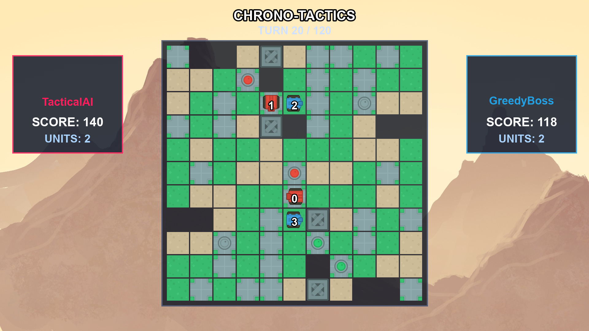
* **Objectif & Règles** : Contrôlez jusqu'à 3 unités sur une arène **11×11** à symétrie centrale dont les cases s'effondrent (`3 -> 2 -> 1 -> 0` = gouffre mortel) et dont les anneaux extérieurs se dégradent tous les 20 tours (**Chrono-Storm**). Capturez les Chrono-Balises (`+2 pts/tour`), détruisez des ponts avec `BOMB tx ty` et poussez les unités adjacentes dans le vide avec `PUSH tx ty`.
* **Sortie par unité** : `[MOVE x y | WAIT] [BOMB tx ty | PUSH tx ty] [MSG text]`

---

### 2. Quantum Relay (`codingame-quantum-relay`)
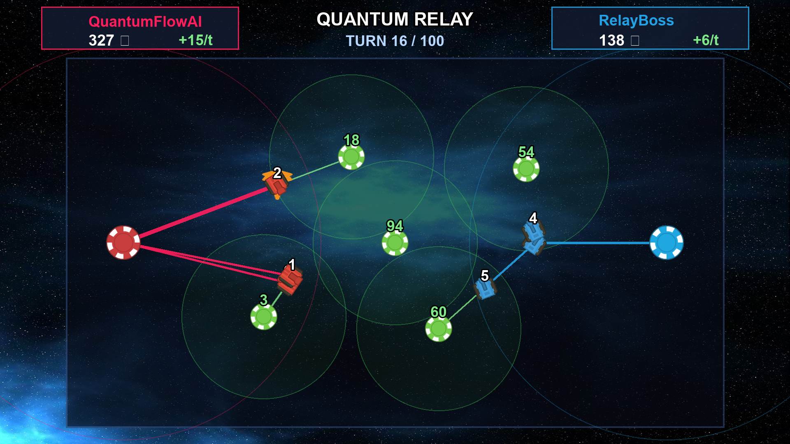
* **Objectif & Règles** : Dans un secteur spatial **1600×900**, déplacez vos drones (`MOVE x y`) pour récolter l'énergie des **Pulsars** et l'acheminer vers votre **Vaisseau-Mère** par faisceaux laser (`LINK targetId`, débit `6`). Utilisez `OVERCHARGE targetId` pour doubler le débit à `12` et dominer les **interférences de faisceaux**.
* **Sortie par drone** : `[MOVE x y [LINK targetId] | OVERCHARGE targetId] [MSG text]`

---

### 3. Corsairs of the Maelstrom (`codingame-corsairs-maelstrom`)
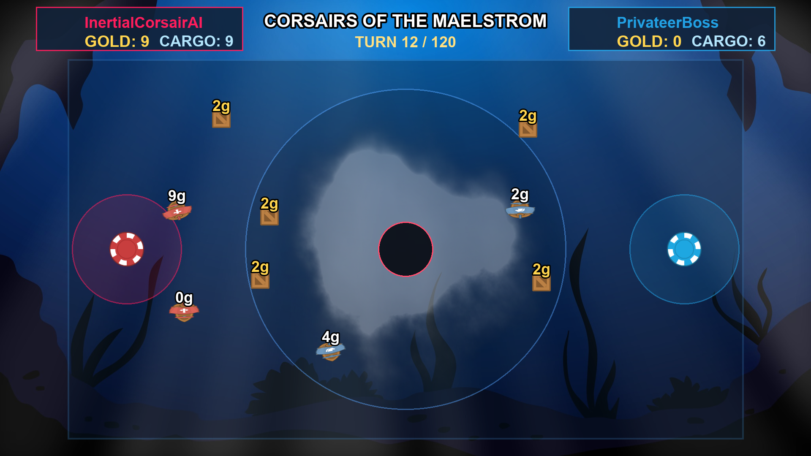
* **Objectif & Règles** : Pilotez jusqu'à 2 navires corsaires soumis à une physique inertielle (`DRAG = 0.78`) à **masse variable selon l'or embarqué** (`accel = power / (1 + 0.15 * gold)`). Collectez les coffres, livrez 35 Or à votre Port, contrecarrez le **Vortex du Maelström** (`(800, 450)`) avec `ANCHOR` et tirez au canon avec `FIRE tx ty`.
* **Sortie par navire** : `[SAIL x y power | ANCHOR] [FIRE tx ty] [MSG text]`

---

### 4. Proving Grounds of Nerdna (`codingame-proving-grounds-nerdna`)
| Mode `RPG SPRITES` | Mode `GEOMETRIC DEBUG` |
| :---: | :---: |
| 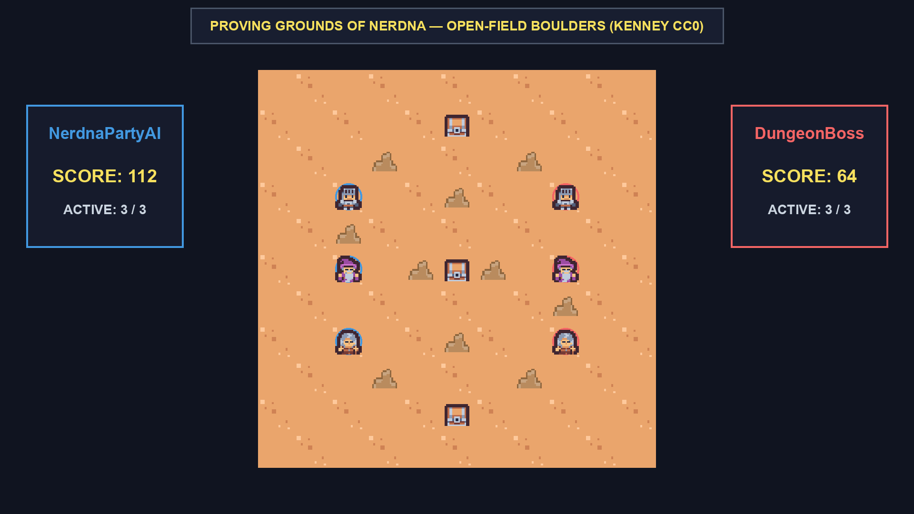 | 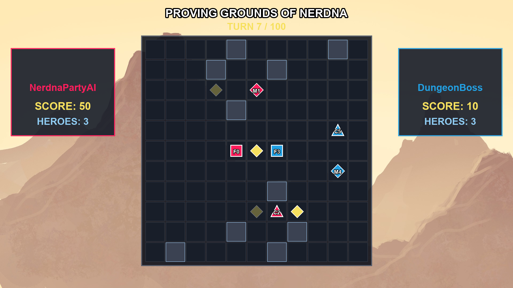 |

* **Objectif & Règles** : Dirigez une compagnie RPG tactique (**Fighter**, **Mage**, **Cleric**) inspirée de *Wizardry* et *D&D 5e* sur un champ de bataille **11×11** parsemé de **rochers** (`#`). Éliminez les Gardiens Morts-Vivants, récupérez les Coffres de Reliques et combinez `SLASH targetId`, `GUARD allyId`, `FIREBALL tx ty` et `HEAL allyId`.
* **Sortie par héros** : `MOVE x y [SLASH id | GUARD id | FIREBALL tx ty | HEAL id]`

---

### 5. Ultima: Dungeon Delver (`codingame-ultima-dungeon-delver`)
| Mode `RPG SPRITES` | Mode `GEOMETRIC DEBUG` |
| :---: | :---: |
| 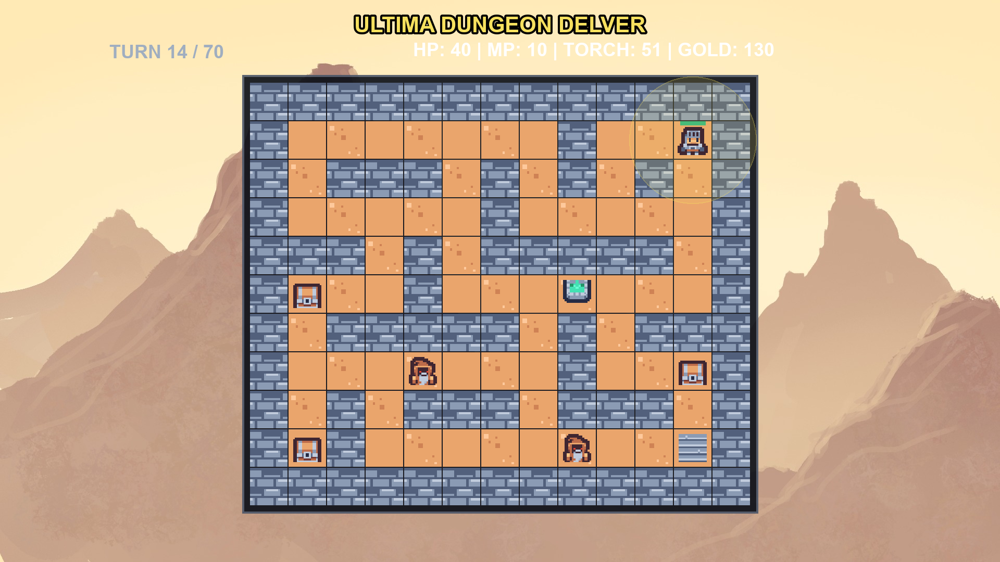 | 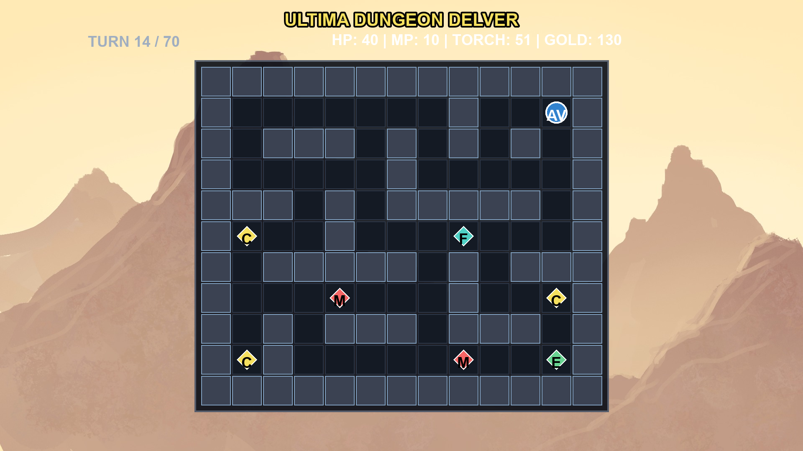 |

* **Objectif & Règles** : Puzzle solo d'Optimisation inspiré d'*Ultima IV*. Guidez l'**Avatar** (`40 PV`, `20 PM`, `65 tours de Torche`) à travers un donjon **13×11**, éliminez les Monstres (`M`) et Gardiens de Reliques (`R`) avec `STRIKE tx ty` ou `FLAM_POR tx ty`, soignez-vous avec `MANI` ou aux Fontaines (`F`) et rejoignez l'Escalier de Sortie (`E`).
* **Sortie par tour** : `MOVE x y | STRIKE tx ty | FLAM_POR tx ty | MANI | WAIT`

---

### 6. Overlord's Labyrinth (`codingame-overlords-labyrinth`)
| Mode `RPG SPRITES` | Mode `GEOMETRIC DEBUG` |
| :---: | :---: |
| 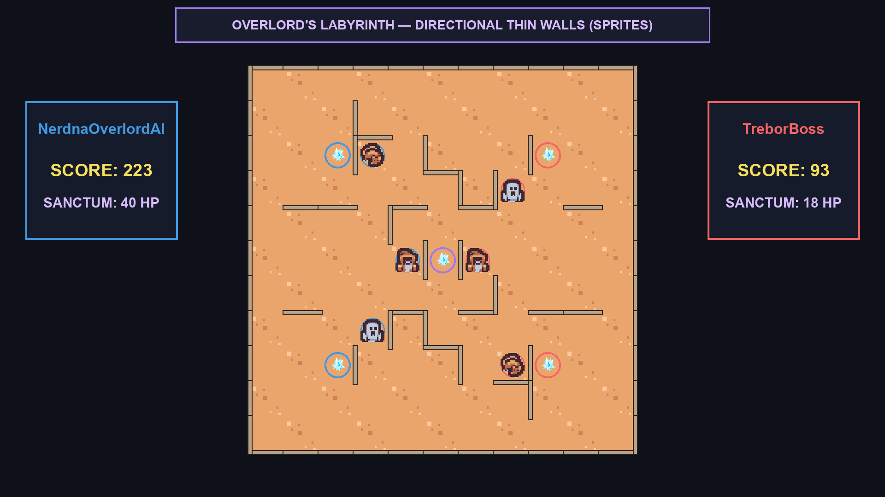 | 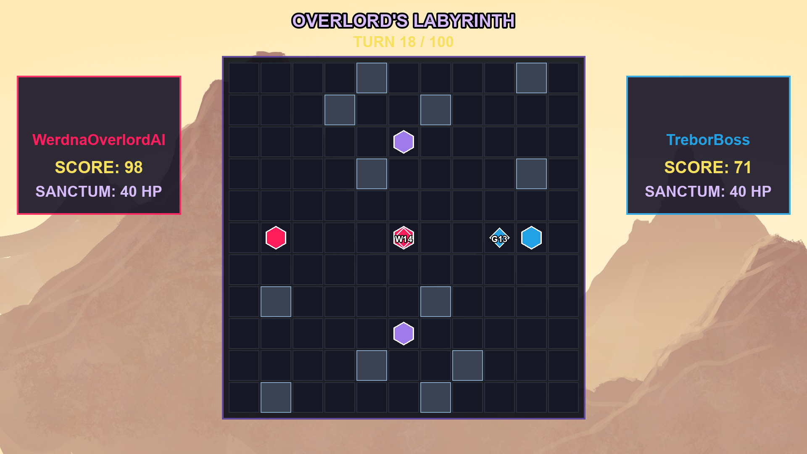 |

* **Objectif & Règles** : Duel tactique inspiré du plateau d'Overlord de *Conan: Book of Skelos* et de *Nerdna*, dans un **labyrinthe 11×11 à cloisons fines directionnelles** (masque hexadécimal `0–F` : `1=N, 2=E, 4=S, 8=O`). Répartissez vos **Gemmes d'Énergie** (`5 + leagueLevel + pentagrammesContrôlés`) entre `SUMMON pentagramId <HOUND|GUARD|WRAITH>` et `ACTIVATE minionId targetX targetY` pour détruire le Sanctuaire adverse (`40 PV`).
* **Sortie par tour** : `SUMMON pentagramId TYPE ; ACTIVATE minionId targetX targetY`

---

### 7. Ironblood: Captive's Raid - Heroes (`codingame-ironblood-raid-heroes`)
| Mode `RPG SPRITES` | Mode `GEOMETRIC DEBUG` |
| :---: | :---: |
| 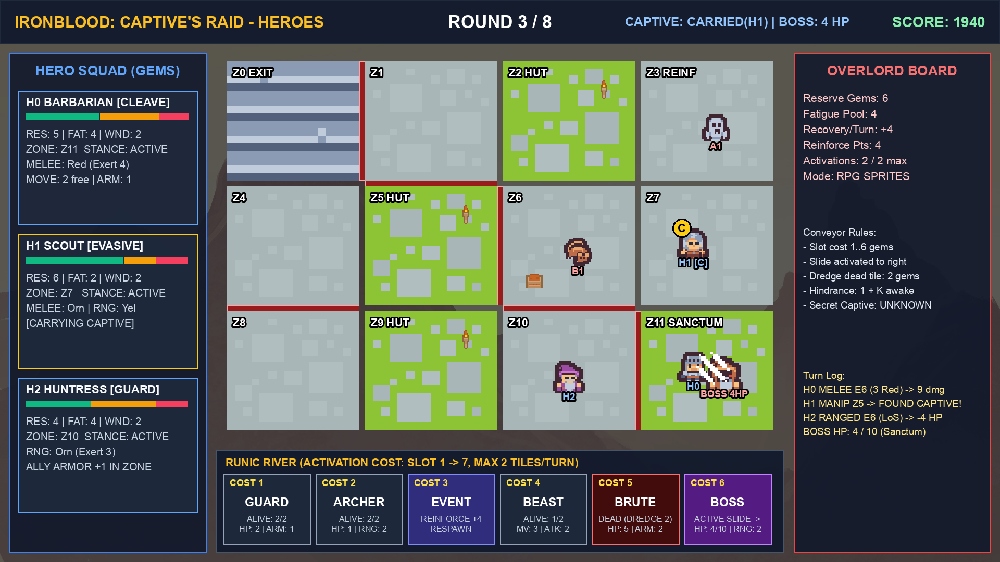 | 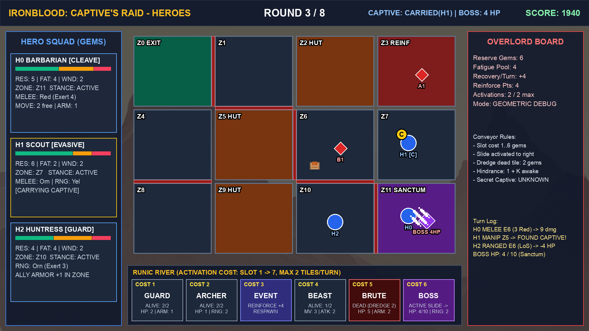 |

* **Objectif & Règles** : Puzzle solo d'optimisation tactique inspiré du jeu de plateau *Conan* (**Monolith Board Games**). Commandez 2 à 3 Héros (`BARBARIAN`, `SCOUT`, `MYSTIC`, `HUNTRESS`) sur un graphe de **12 à 16 Zones planaires** durant **8–9 rounds** avec réserve unique Réserve/Fatigue/Blessures, postures `ACTIVE`/`REST`, combat déterministe à 3 paliers et Gêne pour retrouver la Captive (`MANIP`), abattre le Boss du Sanctuaire et atteindre la Sortie.
* **Sortie par tour** : `[STANCE heroId ACTIVE|REST; MOVE heroId zoneId; MELEE heroId enemyId gems; RANGED heroId enemyId gems; MANIP heroId | WAIT]`

---

### 8. Ironblood: Captive's Raid - Overlord (`codingame-ironblood-raid-overlord`)
| Mode `RPG SPRITES` | Mode `GEOMETRIC DEBUG` |
| :---: | :---: |
| 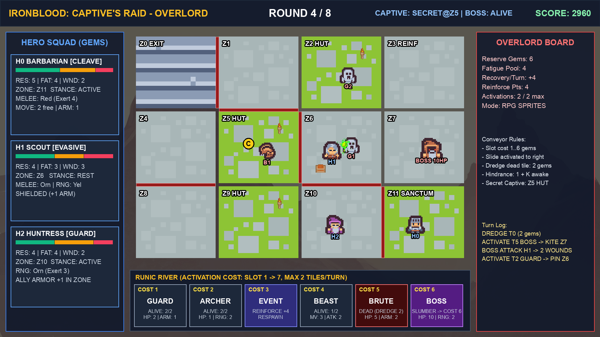 | 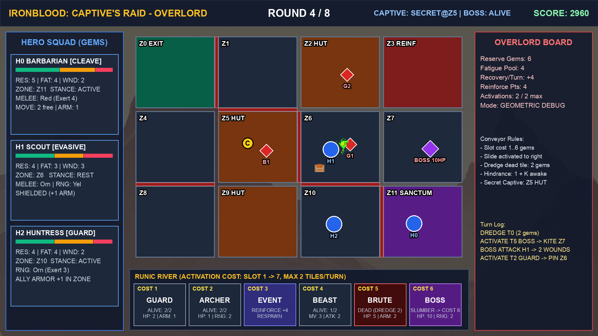 |

* **Objectif & Règles** : Puzzle miroir côté **Overlord** sur le même noyau moteur. Pilotez la **Rivière Runique de 6–8 tuiles** (`0–2` activations/tour selon le coût de position `1..tileCount`, *dredging* à `2` gemmes et Renforts `EVENT`) pour bloquer l'escouade IA par la Gêne, harceler avec le Boss (`ATK_RANGE 2` LoS) et empêcher l'extraction avant la fin des `maxRounds` rounds.
* **Sortie par tour** : `[DREDGE tileId; ACTIVATE tileId; MOVE enemyId zoneId; ATTACK enemyId heroId; REINFORCE tileId spawnZoneId | PASS]`
